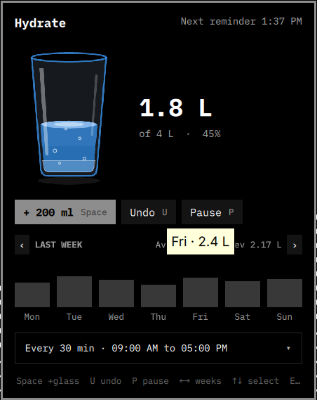
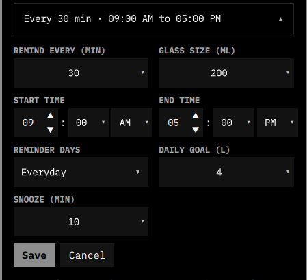

# 🥤 Hydrate — Water Reminder & Intake Tracker for Linux

> _Vibe-coded water reminder and intake tracker for Linux desktops._
  
Hydrate is a small Linux desktop app that helps you record how much water you drink and reminds you when it is time for another drink.

It works from your desktop panel, from the terminal (CLI) and both. Your settings and drinking history are stored locally on your computer.

> **In simple terms:** Hydrate is a water logbook, a reminder clock and a small desktop widget in one application.
  
---
## What Hydrate does

### 1. Tracks your water intake

Record a drink whenever you have water. Hydrate keeps a total for each day and remembers the individual entries.

For example, if your configured glass size is 250 ml and you log three glasses, the daily total becomes 750 ml.

*You can also record a custom amount, such as 500 ml.*
### 2. Shows your progress on the desktop

The panel indicator shows a small glass that fills as you record water. It also displays your current total and daily target 

For Example: `1.5 / 2.5 L`


This lets you check your progress without opening the full panel.
### 3. Displays a dashboard and weekly history

Open the Hydrate panel to see:

- Today's recorded water intake.
- Progress towards your daily tracking goal.
- A visual water glass.
- A Monday-to-Sunday history chart.
- The average for the previous week.
- Settings for reminders and water logging.



Move between weeks with the on-screen arrows or the left and right arrow keys. Hover over a chart bar or day label to see the exact amount recorded for that day.
### 4. Sends reminders

Hydrate can remind you at a regular interval during your chosen hours. 


You can set the interval, snooze time, reminder days and quiet periods.



You can pause reminders temporarily and resume them later. Reminders stop for the day when the configured daily goal is reached.
### 5. Avoids some interruptions

When supported by your desktop environment, Hydrate can hold a reminder while:

- Your screen is locked.
- Do Not Disturb is enabled.
- A fullscreen application is open.
- Your computer has been idle for a configured period.

The reminder is delayed, not discarded. Hydrate checks again and can show it when the condition clears. Detection depends on the desktop and the tools it provides.

### 6. Keeps your records on your computer

Hydrate stores its configuration and intake history locally. You can view individual drinks, export the history to CSV, or create a backup that includes settings and history.

---
## Desktop support

| Desktop / bar            | What you get                                                                                    |
| ------------------------ | ----------------------------------------------------------------------------------------------- |
| **Omarchy / Quickshell** | Native panel indicator and interactive Hydrate panel. This is the main graphical experience.    |
| **Waybar**               | A status indicator with a tooltip, left-click to open the panel and right-click to log a glass. |
| **Other Linux desktops** | Use the CLI or open Hydrate from your desktop application launcher.                             |

---
## Install Hydrate
### 1. Get the project

* Using Git:

```bash
git clone https://github.com/TejaNune1998/Apps-Built-for-Linux.git
cd Apps-Built-for-Linux/Hydrate
```

Or download and extract the ZIP file, then open a terminal in the extracted `Apps-Built-for-Linux/Hydrate` folder.
### 2. Run the installer

```bash
chmod +x install.sh
./install.sh
```

The installer detects an available package manager and attempts to install the required helper programs. It then installs the `hydrate` command, creates the default configuration, sets up the reminder scheduler and detects available desktop integrations.

*You do not need to run the installer as root. It uses `sudo` when it needs to install system packages.*

### 3. Choose a desktop integration (optional)

Normally, the installer detects Omarchy / Quickshell and Waybar automatically.

* To request Quickshell integration:

```bash
./install.sh --quickshell
```

* To request Waybar integration:

```bash
./install.sh --waybar
```

* To skip an integration:

```bash
./install.sh --no-quickshell
./install.sh --no-waybar
```

* *You can combine options. For example:*

```bash
./install.sh --quickshell --no-waybar
```

*If neither panel integration is installed, you can still use Hydrate from the terminal or the desktop application launcher.*

### 4. Check the installation

```bash
hydrate doctor
```

This checks the installation and reports useful information, including conditions that may currently be holding reminders back.

---
## Use the desktop panel
### Open the panel

- **Omarchy / Quickshell:** Click the Hydrate glass in the top bar.
- **Waybar:** Left-click the Hydrate status item.
- **Other desktops:** Search for **Hydrate** in your application launcher, or run:

```bash
hydrate panel
```
### Panel indicator actions

| Action                   | What it does                                |
| ------------------------ | ------------------------------------------- |
| Hover over the indicator | Shows your intake and reminder information. |
| Left-click               | Opens the Hydrate panel.                    |
| Right-click              | Records one glass of water.                 |

The exact click behaviour depends on the desktop integration.
### Keyboard controls in the Omarchy panel

| Key       | What it does                                                            |
| --------- | ----------------------------------------------------------------------- |
| `↑` / `↓` | Move between available controls. A ring indicates the selected control. |
| `Enter`   | Activate the selected control.                                          |
| `Space`   | Log a glass, or activate the selected control.                          |
| `U`       | Undo the most recent drink entry.                                       |
| `P`       | Pause or resume reminders.                                              |
| `←` / `→` | Move between weeks or change the selected setting.                      |
| `Esc`     | Clear the selection, then close the panel.                              |

When settings are open, use the arrow keys to change the selected option. Start and end times have separate controls for the hour, minutes and AM/PM. Select **Save** to apply changes or **Cancel** to discard them.

---
## Use the command line (CLI)

The CLI lets you use Hydrate without opening the graphical panel. Open a terminal and run commands beginning with `hydrate`.

### Everyday commands

| Command           | Meaning                                                   |
| ----------------- | --------------------------------------------------------- |
| `hydrate panel`   | Open the graphical panel.                                 |
| `hydrate status`  | Show today's total and daily goal in one short line.      |
| `hydrate log`     | Record one glass using your configured glass size.        |
| `hydrate log 500` | Record 500 ml. The amount must be between 1 and 3000 ml.  |
| `hydrate undo`    | Remove the most recently recorded drink entry.            |
| `hydrate reset`   | Clear today's total and today's individual drink entries. |
| `hydrate pause`   | Stop reminders temporarily.                               |
| `hydrate resume`  | Start reminders again.                                    |
| `hydrate alert`   | Display a test reminder.                                  |
| `hydrate version` | Show the installed Hydrate version.                       |

**Note:** *Be careful with `hydrate reset`: it clears today's records. It does not just reset the progress display.*

### View history and statistics

| Command                      | Meaning                                                               |
| ---------------------------- | --------------------------------------------------------------------- |
| `hydrate stats`              | Show daily totals for this week.                                      |
| `hydrate stats -1`           | Show daily totals for the previous week.                              |
| `hydrate stats -2`           | Show daily totals from two weeks ago.                                 |
| `hydrate week`               | Print this week's data as JSON, useful for integrations.              |
| `hydrate week -1`            | Print the previous week's data as JSON.                               |
| `hydrate entries`            | List the individual drinks recorded today.                            |
| `hydrate entries yesterday`  | List yesterday's individual drinks.                                   |
| `hydrate entries 2026-11-06` | List entries for a particular date (use `YYYY-MM-DD`).                |
| `hydrate entries --all`      | List entries from up to the 30 most recent days with recorded totals. |
| `hydrate schedule`           | Show the reminder schedule for each day.                              |

The week offset is relative to the current week: `0` means this week, `-1` means last week, and `-2` means two weeks ago.
### Change settings

Use this format:

```bash
hydrate set SETTING VALUE
```

For Examples:

```bash
hydrate set interval 60
hydrate set snooze 10
hydrate set glass 300
hydrate set goal 2500
hydrate set days weekdays
```

  

Available settings:

| Command                       | Meaning                                    | Accepted values                        |
| ----------------------------- | ------------------------------------------ | -------------------------------------- |
| `hydrate set interval 60`     | Time between reminders                     | `30`, `45`, `60` or `90` minutes       |
| `hydrate set snooze 10`       | Delay after snoozing/dismissing a reminder | `5`, `10`, `15`, `20` or `30` minutes  |
| `hydrate set glass 300`       | Amount added by a one-glass action         | `200`, `250`, `300`, `350` or `400` ml |
| `hydrate set goal 2500`       | Daily tracking target                      | `2000` to `6000` ml, in 500 ml steps   |
| `hydrate set days all`        | Enable the normal schedule every day       | `all` or `weekdays`                    |
| `hydrate set start 9`         | Set the reminder start hour                | 24-hour hour number                    |
| `hydrate set start_minute 30` | Set the reminder start minutes             | `0`, `15`, `30` or `45`                |
| `hydrate set end 17`          | Set the reminder end hour                  | 24-hour hour number                    |
| `hydrate set end_minute 0`    | Set the reminder end minutes               | `0`, `15`, `30` or `45`                |

For example, to set reminders from 9:30 AM to 5:00 PM:

```bash
hydrate set start 9
hydrate set start_minute 30
hydrate set end 17
hydrate set end_minute 0
```

The daily goal is a personal tracking setting, not a medical recommendation. Hydration needs differ from person to person.

### Set a different schedule for a particular day

You can give an individual day its own reminder window.

```bash
hydrate set day mon 09:00-17:30
hydrate set day sat 10:00-14:00
```

Turn reminders off for a day:

```bash
hydrate set day sun off
```

Return a day to the normal schedule:

```bash
hydrate set day sun default
```

  Use `mon`, `tue`, `wed`, `thu`, `fri`, `sat` or `sun` (full day names also work).

### Set quiet hours

Quiet hours are periods when Hydrate should not show reminders. You can set more than one period, separated by commas.
  
```bash
hydrate set quiet 12:00-13:00,15:00-15:30
```

Turn quiet hours off:
```bash
hydrate set quiet off
```

### Control when reminders are held back

These options control whether Hydrate should wait during certain desktop conditions:

```bash
hydrate set skip locked on
hydrate set skip dnd on
hydrate set skip fullscreen on
hydrate set skip idle 15
```

Meaning:

| Command                           | Meaning                                                                         |
| --------------------------------- | ------------------------------------------------------------------------------- |
| `hydrate set skip locked on`      | Hold reminders while the screen is locked.                                      |
| `hydrate set skip locked off`     | Do not check the screen-lock state.                                             |
| `hydrate set skip dnd on`         | Hold reminders while Do Not Disturb is active.                                  |
| `hydrate set skip dnd off`        | Do not check Do Not Disturb.                                                    |
| `hydrate set skip fullscreen on`  | Hold reminders while a fullscreen app is active.                                |
| `hydrate set skip fullscreen off` | Do not check for fullscreen apps.                                               |
| `hydrate set skip idle 15`        | Hold reminders when the computer has been idle for 15 minutes, where supported. |
| `hydrate set skip idle off`       | Turn off idle-based postponement.                                               |

The lock, Do Not Disturb and fullscreen checks are enabled by default. Idle postponement is disabled by default. Desktop support for detecting these conditions varies.

### Export, back up and restore your data

```bash
hydrate export
```

Exports your drink history as a CSV file. You can open the CSV in a spreadsheet application. You can also choose the output file:

```bash
hydrate export ~/Documents/hydrate-history.csv
```

Create a backup containing your settings and intake history:

```bash
hydrate backup
```

Choose a backup filename:

```bash
hydrate backup ~/Documents/hydrate-backup.tar.gz
```

Restore from a backup:

```bash
hydrate restore ~/Documents/hydrate-backup.tar.gz
```

  
Keep backups somewhere safe. Restoring a backup replaces the corresponding Hydrate settings and history with the backed-up data.

### Check and repair the installation

```bash
hydrate doctor
```

Use this first when something is not working. It checks the installation and reports reminder blockers it can detect.

---

## Configure Hydrate

You can change most everyday settings from the graphical panel or the CLI.

| Setting                        |         Default | Available choices             |
| ------------------------------ | --------------: | ----------------------------- |
| Daily tracking goal            | 2500 ml (2.5 L) | 2000–6000 ml, in 500 ml steps |
| Glass size                     |          250 ml | 200, 250, 300, 350 or 400 ml  |
| Reminder interval              |      45 minutes | 30, 45, 60 or 90 minutes      |
| Snooze duration                |      10 minutes | 5, 10, 15, 20 or 30 minutes   |
| Reminder start                 |         8:00 AM | Configurable                  |
| Reminder end                   |        10:00 PM | Configurable                  |
| Reminder days                  |       Every day | Every day or weekdays         |
| Lock / DND / fullscreen checks |              On | On or off                     |
| Idle postponement              |             Off | Off or 1–240 minutes          |

Per-day schedules and quiet hours are configured through the CLI. A per-day schedule can override the general every-day or weekdays setting for that day.

---
## Where Hydrate stores its files

Hydrate keeps its files in your home directory. You normally do not need to edit these files manually.

### 1. Settings

```text
~/.config/hydrate/
├── config
├── source
└── install-flags
```

  
- `config` — your goal, glass size, reminder interval, schedule and other preferences.
- `source` — the folder from which Hydrate was installed. The updater uses this location.
- `install-flags` — installer options used during installation.

### 2. Daily intake history and runtime state

By default:

```text

~/.local/state/hydrate/
├── 2026-11-06.ml
├── 2026-11-06.log
├── 2026-11-07.ml
├── 2026-11-07.log
├── next_due
├── changed
└── data.lock
```

The date in these filenames is an example.

  
- `YYYY-MM-DD.ml` — the total amount recorded for that day, in millilitres.
- `YYYY-MM-DD.log` — individual drink entries, including their time and amount. Hydrate uses this file for the entry list and undo operation.
- `next_due` — the next scheduled reminder time.
- `changed` — a small marker used to tell the desktop indicator that its display should refresh.
- `data.lock` — helps prevent two actions from changing the same day's records at the same time.

If you set `XDG_STATE_HOME`, Hydrate uses `$XDG_STATE_HOME/hydrate/` instead of `~/.local/state/hydrate/`.

### 3. Installed application and desktop integration files

Common locations include:

| Location                                      | Purpose                                           |
| --------------------------------------------- | ------------------------------------------------- |
| `~/.local/bin/hydrate`                        | The CLI program.                                  |
| `~/.config/systemd/user/hydrate.service`      | The user-level reminder service.                  |
| `~/.config/systemd/user/hydrate.timer`        | Runs the reminder check every minute.             |
| `~/.local/share/applications/hydrate.desktop` | Adds Hydrate to the application launcher.         |
| `~/.config/omarchy/plugins/hydrate/`          | Omarchy / Quickshell integration, when installed. |
| `~/.config/waybar/hydrate.jsonc`              | Waybar module configuration, when installed.      |

---
## How reminders work

  
Hydrate uses a user-level systemd timer when a systemd user session is available. The timer runs a small check every minute. Hydrate checks whether a reminder is due and whether your schedule or desktop conditions say it should wait.

  
The reminder service is separate from the graphical panel. **You can close the panel and reminders can continue running.**

  
To see the timer:

```bash
systemctl --user list-timers hydrate.timer
```

To see recent reminder service logs:

```bash
journalctl --user -u hydrate.service -n 20 --no-pager
```

If a systemd user session is not available, the installer uses a desktop autostart entry and starts the background process instead.

---

## Update Hydrate

Run:

```bash
hydrate update
```

Hydrate checks the `main` branch of the project's GitHub repository and looks for the latest published release.

- If a release is available, Hydrate downloads that release archive.
- If there is no published release, it downloads the latest source archive from the `main` branch.
- It reads the available version from `omarchy/manifest.json` and compares it with the installed version.
- If the installed version is already current, or the available version is older, Hydrate exits without changing the installation or creating an update backup.
- If a newer version is available, Hydrate backs up your settings, history and installed application files before updating.

Backups are stored under:

```text
~/.local/share/hydrate/backups/
```


Hydrate keeps your existing settings and drinking history. If the updated installation fails its verification, it restores the previous application files. Your settings and history are kept in place.

  
The updater works whether you originally installed Hydrate from a Git checkout or a ZIP archive. You do not need to manually replace files in the original extracted project folder. An internet connection and the `git`, `curl`, `unzip` and `tar` commands are required.

---
## Uninstall or completely remove Hydrate

There are two removal options. Choose the one that matches what you want.

### Option 1: Uninstall the application but keep your data

  
```bash
hydrate uninstall
```

  
Hydrate asks for confirmation, removes the application and its desktop integrations, but keeps your settings and intake history. This is useful if you may install Hydrate again later.

To skip the confirmation (for scripts):

```bash
hydrate uninstall --yes
```

### Option 2: Remove Hydrate and delete all its data

```bash
hydrate purge
```

  
Hydrate asks you to type `purge` before continuing. This removes the application, settings and recorded intake history. **This is permanent unless you have a backup.**

To skip the confirmation (for scripts):

```bash
hydrate purge --yes
```

### Which should I choose?

| If you want to…                                   | Use                 |
| ------------------------------------------------- | ------------------- |
| Remove the app but keep your history and settings | `hydrate uninstall` |
| Remove the app and erase all Hydrate data         | `hydrate purge`     |

---
## Troubleshooting

### The panel indicator is missing

For Omarchy, try:

```bash
omarchy plugin enable hydrate right
omarchy-restart-shell
```

For Waybar, check that the Hydrate module is included in your Waybar configuration, then reload Waybar:

```bash
pkill -SIGUSR2 waybar
```

### Reminders are not appearing

Start with:

```bash
hydrate doctor
systemctl --user list-timers hydrate.timer
journalctl --user -u hydrate.service -n 20 --no-pager
```

*Also check that reminders are not paused, that the current time is inside your configured schedule, and that the daily goal has not already been reached.*

### Useful quick checks

```bash
hydrate status
hydrate schedule
hydrate doctor
```

---
## Distribution support

The installer looks for one of these package managers:

| Distribution family   | Package manager | Project status                       |
| --------------------- | --------------- | ------------------------------------ |
| Arch Linux / Omarchy  | `pacman`        | Tested                               |
| Debian / Ubuntu       | `apt`           | Supported, not tested by the project |
| Fedora / RHEL / Rocky | `dnf` / `yum`   | Supported, not tested by the project |
| openSUSE              | `zypper`        | Supported, not tested by the project |

The installer may need additional dependencies or manual configuration on some desktop environments.

---
## Tests

Run the included tests from the project folder:

```bash
bash tests/run.sh
bash tests/run-qml.sh
```

The QML tests require Qt 6 `qmltestrunner`. Tests that cannot run because a required tool is unavailable may be skipped.

---
## License

Hydrate is released under the [MIT License](LICENSE).
