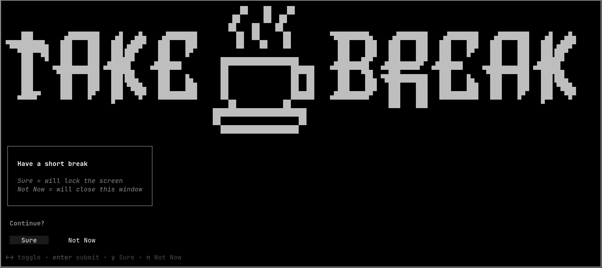

# Take-a-Break

A small Linux utility that reminds you to take short breaks and regular meal breaks.

Take a Break runs in the background using **systemd user timers**. When a reminder is due, it opens a terminal dialog. You can lock your screen, or postpone/close the reminder.

## What it does

- **Short breaks:** Opens a reminder at a repeating interval you choose.
- **Meal breaks:** Reminds you about breakfast, lunch and dinner at the times you configure.
- **Screen lock:** Choosing **Sure** runs `omarchy system lock`.
- **Meal snooze:** Choosing the snooze option postpones the meal reminder by 30 minutes. You can snooze up to two times.
- **Terminal dialog:** Uses [Gum](https://github.com/charmbracelet/gum) for the message box and confirmation when installed. A basic Bash dialog is used if Gum is unavailable.
- **ASCII banners:** Displays a coffee or tea banner for the break dialogs.



## Requirements

Take a Break is designed for an Omarchy/Hyprland desktop.

- Bash
- systemd user session
- Hyprland (`hyprctl`)
- `xdg-terminal-exec`
- Omarchy's `omarchy system lock` command
- Gum (optional; used to improve the dialog appearance)

The setup script also uses standard Linux utilities such as `date`, `awk`, `sed`, `cp` and `systemctl`.

## Install

1. Get the project
```
git clone https://github.com/TejaNune1998/Apps-Built-for-Linux.git
cd Apps-Built-for-Linux/Take-a-Break
```
2. Run the setup script:

   ```bash
   chmod +x setup.sh
   ./setup.sh
   ```

3. Answer the setup questions:
   - Choose `coffee` or `tea` for the banner.
   - Set the short-break interval in `HH:MM` format, for example `01:30`.
   - Enter your breakfast, lunch and dinner times. You can use 12-hour or 24-hour time, for example `09:00 AM` or `13:00`.

The setup script copies the application to:

```text
~/.Take-a-Break/
```

It creates the systemd user service and timer files, reloads systemd, and enables the short-break and meal-break timers.

**You do not need to run the installer with `sudo`.**

## How reminders work

### Short breaks

- The short-break timer runs at the interval you selected during setup.
- Short-break reminders are skipped during the hour before and the hour after each configured meal time.
- When a reminder appears:
  - **Sure** locks the screen.
  - **Not Now** closes the reminder.

### Meal breaks

- Meal reminders are scheduled daily for breakfast, lunch and dinner.
- Choosing **Sure** locks the screen.
- Choosing **Snooze** schedules the reminder again in 30 minutes.
- You can snooze a meal reminder up to two times. After that, the dialog offers **Not Now** instead.

The reminder dialogs are opened in a floating terminal window through Hyprland.

## Change your schedule

Run the setup script again from the installed directory:

```bash
cd ~/.Take-a-Break/
./setup.sh
```

If Take a Break is already installed, choose:

- `m` or `modify` to change the beverage, short-break interval or meal times.
- `u` or `uninstall` to remove Take a Break.

When modifying the setup, the script stops the timers, restores the original service and timer templates, asks for the new settings, then enables the timers again.

## Check the timers

List the active user timers:

```bash
systemctl --user list-timers
```

Check the short-break timer:

```bash
systemctl --user status take-a-short-break.timer
```

Check the meal-break timer:

```bash
systemctl --user status take-a-meal-break.timer
```

View recent service logs:

```bash
journalctl --user -u take-a-short-break.service
journalctl --user -u take-a-meal-break.service
```

## Project files

```text
Take-a-Break/
├── assets/
│   ├── break.txt
│   ├── coffee-ascii.txt
│   ├── tea-ascii.txt
│   └── meal-ascii.txt
├── scripts/
│   ├── short-break/
│   │   ├── short-break-dialog.sh
│   │   ├── taka-a-short-break.sh
│   │   └── systemd/
│   │       ├── take-a-short-break.service
│   │       └── take-a-short-break.timer
│   └── meal-break/
│       ├── meal-break-dialog.sh
│       ├── take-a-meal-break.sh
│       └── systemd/
│           ├── take-a-meal-break.service
│           └── take-a-meal-break.timer
└── setup.sh
```

- `setup.sh` installs, configures, modifies and uninstalls the utility.
- `assets/` contains the ASCII banners.
- `short-break/` contains the short-break dialog, launcher and systemd units.
- `meal-break/` contains the meal-break dialog, launcher and systemd units.

## Uninstall

Run the setup script again from installed directory:

```bash
cd ~/.Take-a-Break/
./setup.sh
```

When prompted, enter `u` or `uninstall`.

The uninstall option stops and disables both timers, removes their user systemd unit files, and deletes:

```text
~/.Take-a-Break/
```

## Notes

- The application uses **Omarchy/Hyprland-specific commands** to open the floating terminal and lock the screen. _It is not currently a desktop-environment-independent utility_.
- Meal reminders use the configured hour to decide whether to show the breakfast, lunch or dinner dialog.
- Keep the project directory available when running `setup.sh` to modify or uninstall the application.
